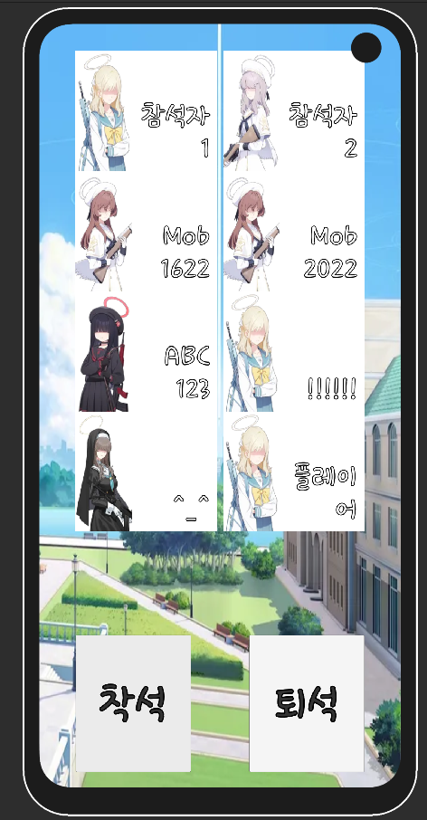
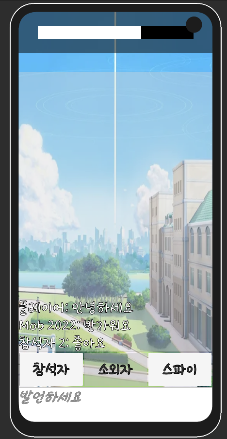
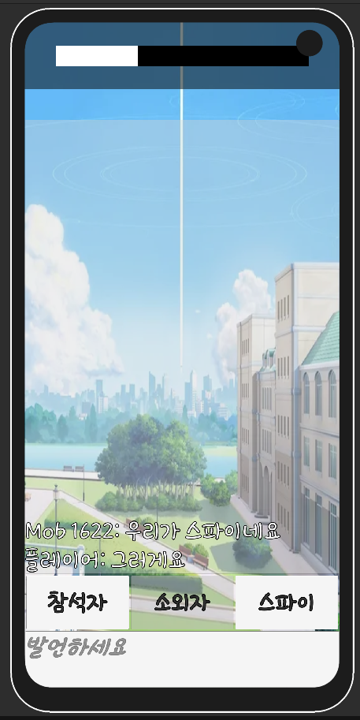
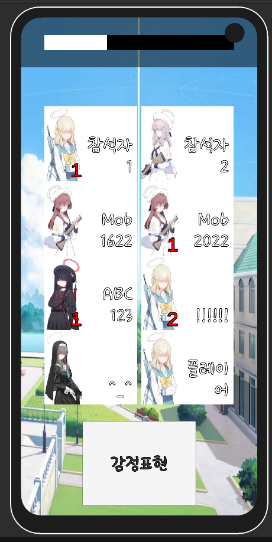

# T-Party

『블루 아카이브』 팬 게임. 여러 명이 접속해 숨어 있는 **스파이**를 찾아내는 온라인 정체 숨기기(마피아류) 게임 (Unity · Photon PUN, 2023~2024).

   

- 로비에서 방을 만들거나 들어가 착석, 인원이 모이면 시작
- 게임 시작 시 일부 플레이어가 무작위로 스파이가 된다
- 하루가 **아침 · 저녁 · 밤**으로 돌아간다
  - 아침: 채팅으로 토론
  - 저녁: 감정표현만으로 의사 표시 · 투표
  - 밤: 스파이와 탈락자만 행동
- 투표 결과로 탈락자가 정해지고, 진영 승패에 따라 게임 결과 표시

> 비공식 팬 제작물이며 NEXON Games · Yostar와 관계가 없습니다. 원작 일러스트가 포함되어 있어 실행 파일은 배포하지 않습니다.
